 

 

## 🧭 &nbsp;About Me

I'm a backend developer at **TrustSoft** and a final-year Software Engineering student at **FPT University** in Hanoi.
I build the backend side of AI products: LLM agents, speech features, and the APIs, data and security that keep them reliable.

- 🔭 **Now:** AI meeting assistants and conversational commerce agents at work
- 🧩 **Side project:** [sloplint](https://github.com/callmehai/sloplint), a linter that catches the "AI-generated" look in web UIs
- 🏆 **Background:** competitive programming since high school (Vietnam Olympiad in Informatics, ICPC)

 

## 🧰 &nbsp;Tech Stack

<picture>
  <source media="(prefers-color-scheme: dark)" srcset="https://skillicons.dev/icons?i=go,python,cs,dotnet,ts,react,postgres,redis,mongodb,docker,git,linux&theme=dark" />
  
</picture>

  

+ &nbsp;FastAPI &nbsp;·&nbsp; LangGraph &nbsp;·&nbsp; REST APIs &nbsp;·&nbsp; NATS &nbsp;·&nbsp; SignalR &nbsp;·&nbsp; TDD &nbsp;·&nbsp; CI/CD

 

## 📌 &nbsp;Things I've Built

| Project | What it is | Stack |
| --- | --- | --- |
| [sloplint](https://github.com/callmehai/sloplint) | Finds UI patterns that make a front-end look AI-generated and suggests what design systems do instead | JavaScript, Playwright |
| [Workspace Hub](https://github.com/callmehai/workspace-hub) | Gmail, Calendar, Drive and Jira in one Kanban workspace with two-way sync | ASP.NET 8, React, SQL Server |
| [ScanGo](https://github.com/callmehai/scango) | Snap a product label, get OCR + an AI explanation or translation | Node.js, .NET 10, Gemini |
| [Template-ICPC](https://github.com/callmehai/Template-ICPC) | My contest notebook: segment trees, HLD, Li Chao, geometry, number theory | C++ |

 

## 🐍 &nbsp;Contribution Snake

<picture>
  <source media="(prefers-color-scheme: dark)" srcset="https://raw.githubusercontent.com/callmehai/callmehai/output/snake-dark.svg" />
  
</picture>

